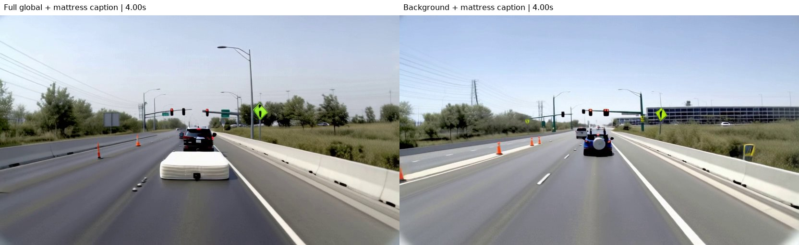
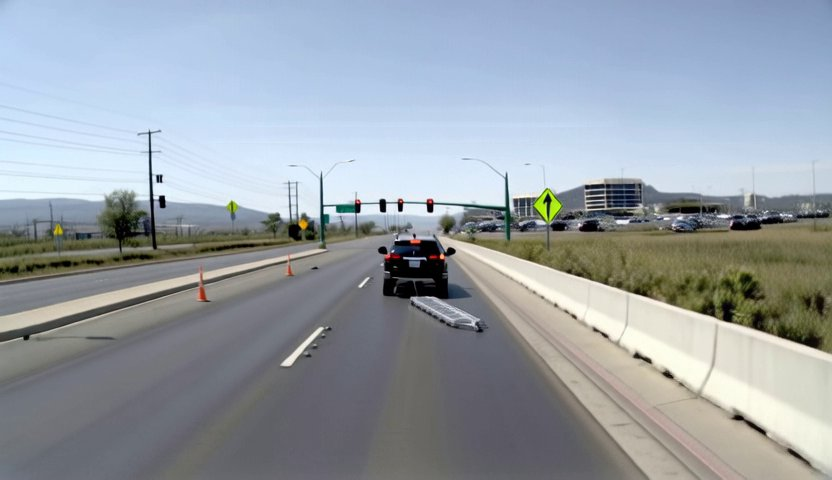
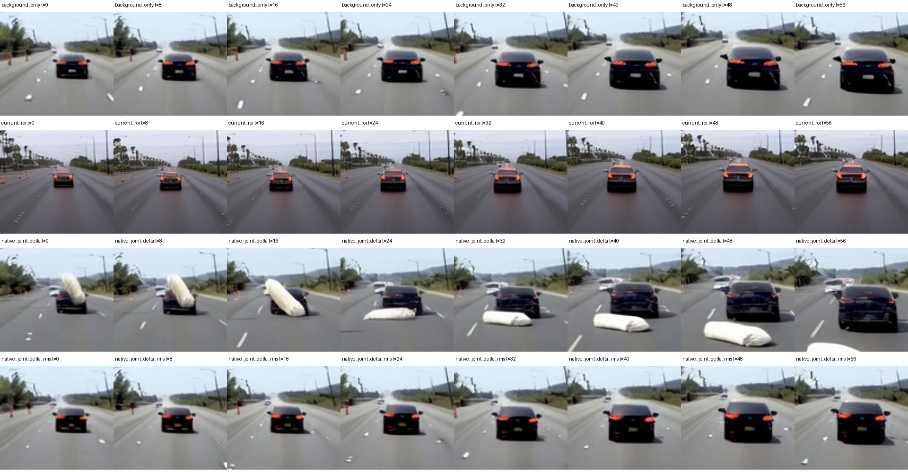

# 从对象文本接入到原生联合 Attention：一周研究进展

我们希望在道路视频生成中，用一句对象描述控制指定目标的外观和行为，例如让动物横穿道路，或让前车上的床垫掉到路面。基础系统是 Wan2.1-VACE-14B，加上道路地图和 3D 框控制：地图约束道路结构，框提供对象的位置与运动，文字补充类别、外观和动作。

这一周主要沿着一个问题推进：**视频里出现了目标，到底是全局描述在起作用，还是绑定到目标框的对象描述在起作用？**

## 1. 最初：把对象文本拼到 box 后面，再加 attention mask

最初通过对象 ID，把每段对象描述绑定到对应的 box。对象文本编码后拼到 box 条件序列的最后面，再用 attention mask 控制读取关系，使描述与指定对象关联。全局视频描述仍走 Wan 原来的文本通路。

这里的 attention mask 控制的是条件之间的读取关系；后面加入的目标框画面区域限制，是进一步的修改。

生成中能看到床垫等内容，但这还不能说明新增对象描述学会了控制，因为全局描述本身也写着同一事件。

[观看：全局包含床垫事件时，开启与关闭对象描述的对照](videos/early-object-on-off.mp4)

## 2. 分开全局与对象描述：发现事件主要依赖全局文字

我们固定场景和随机种子，比较完整全局描述、只讲道路背景的全局描述，以及对象描述的开关和替换。

结果是：全局仍写床垫掉落时，关闭对象描述也能出现床垫；全局只保留道路背景后，即使对象描述仍要求床垫掉落，也没能保留清楚的事件。把对象描述从床垫改成梯子，画面会变，但未可靠生成对应物体。

因此训练开始采用背景版全局描述，让对象内容更多由对象描述提供。中间版本主要使用背景描述，也保留部分完整全局描述；后来的独立对象文本分支，对有对象描述的训练样本使用背景版全局描述。



[观看：左为完整全局描述，右为仅背景描述；对象文字均要求床垫掉落](videos/early-global-vs-background.mp4) · [观看：同背景下，床垫／梯子／关闭对象描述](videos/early-object-replacement.mp4)

**这一阶段的发现：能生成事件，不等于绑定到框的对象文字能独立控制事件。**

## 3. 改注意力读取：让有描述的对象获得独立的控制信号

仅修改全局描述还不够，我们随后调整了读取结构：几何控制保持独立，有描述的对象另行读取，避免它们与大量普通对象争夺同一次注意力分配。中间版本使用“融合输出减几何参考”的增量，之后又尝试直接注入对象读取结果，减少参考相减可能抵消有效信号的问题。

这里的差分发生在几何控制分支里，**与后面 Wan 原生文本 attention 的联合差分不是同一种方法**。这些版本也没有显式把对象文字限制在画面的目标框区域。

直接注入版本出现过清楚的梯子落到道路上的正例，但不能据此认定类别、动作和实例绑定已经普遍可靠。



[观看：直接对象读取版本，背景全局描述＋对象文字要求梯子掉落](videos/direct-ladder.mp4)

## 4. 补强目标框区域重建

接着，我们保留全视频生成损失，同时增加目标框对应区域的重建权重，希望训练更关注指定对象。床垫没有自己的逐帧轨迹，因此额外区域权重只加在前车框上，完整掉落过程仍由全视频损失监督。

结果并非稳定改善：同一个梯子验证输入，父版本能看到梯子，加入区域重建后的检查点却生成了白色货物样物体。这个回退说明局部重建不能直接替代文本语义学习，但不能仅凭一次续训对比断言损失设计就是原因。

[观看：增加区域重建后的梯子指令失败样例](videos/region-loss-ladder.mp4)

## 5. 加入目标框区域内的独立文本注意力

下一版不再把对象文字压缩后混入几何条件，而是保留 Wan 的文本特征，在原生全局文本 attention 之后增加对象文本注意力，并根据目标框投影出来的区域注入。该分支借用原生 attention 权重，加入低秩适配和可学习门控；主干与已有几何控制冻结。

对于床垫这类载物描述，当时另外尝试了从前车特征向全图路由的机制，希望影响能够离开前车框。

检查发现文字确实进入模型，也确实改变像素，但类别和动作仍未稳定命中：狗没有清楚生成，床垫与梯子、掉落与固定等描述的区别也不够明显。

[观看：独立文本分支的床垫掉落指令，未看到清楚掉落过程](videos/mattress-independent.mp4)

其间还修复过一次续训未正确恢复冻结控制权重的问题。它属于工程恢复故障，不是架构改进；修复后的结果仍暴露出语义控制问题。因此不能把所有失败都解释为恢复故障，也不能把 loss 下降当成控制成功。

## 6. 最近：让对象描述直接走 Wan 原生联合文本 Attention

独立分支虽然借用了原生权重，却不等于对象文字走了原生完整文本通路。因此我们在固定权重上做了新的推理实验：

```text
背景文本 → 原生 attention → 背景输出
背景＋对象文本 → 同一个原生 attention → 联合输出
在目标框区域加入：联合输出 − 背景输出
```

两次 attention 使用同一个视频 query；“背景＋对象文字”先作为完整句子编码。这里不改训练，也没有训练新模型。

在同一个第 1500 步检查点上，我们固定各场景种子，比较背景基线、独立文本分支、联合差分和 25% RMS 缩放差分。视频均为 416×240、57 帧、50 步、CFG 5。**阶段之间展示的是研究演变，不是统一基准；这一阶段内部才是配对比较。**

### 正向单例：床垫掉落

未缩放的联合差分中，可以看到床垫先在前车上，随后落到车后路面。背景基线和独立文本分支未呈现同样清楚的过程；25% RMS 缩放则基本压掉了这一效果。



[背景基线](videos/mattress-background.mp4) · [独立文本分支](videos/mattress-independent.mp4) · **[联合差分的床垫正例](videos/mattress-joint.mp4)** · [RMS 缩放版](videos/mattress-rms.mp4)

我们又做了两项检查：将注入区域向右移动约整幅画面宽度的 35% 后，没看到清楚的床垫；把床垫词换成梯子后，出现了不同的橙色狭长物体，但不能确认它是合格的梯子。它们初步支持文字内容和注入位置都在影响结果，尚不能证明可靠轨迹绑定。

[错位区域对照](videos/mattress-displaced.mp4) · [床垫词替换为梯子](videos/mattress-wrong-word.mp4)

### 仍然失败：狗生成

狗场景依然没有清楚生成狗。真实网格检查发现，狗在有覆盖的时间片只有 2–8 个空间 query，部分时间片为零，说明低覆盖值得关注，但不能仅凭一个案例认定它就是原因。

[观看：狗横穿失败](videos/dog-joint.mp4)

背景与独立分支的六条基线已重新完整生成，新旧视频逐字节一致，排除了旧基线复用造成的实际结果不一致。更多种子复现后来按要求中止，没有完成结果；上述新方案仍是每场景一个种子的探索证据。

## 7. 目前的判断与下一版方向

这一周的进展不是“已经解决细粒度控制”，而是逐步分清了问题：全局文字能生成目标，不代表对象文字能独立控制；文字能改变像素，也不代表类别、动作和对象绑定正确。

**联合 attention 差分是目前值得保留的方向：床垫单例说明沿原生文本路径可能更容易激活对象与动作语义，但对象绑定、狗生成失败和框外变化仍未解决，尚不足以替换正式架构。**

最新讨论的下一版计划是统一使用一个对象控制分支：对象描述同时包含外观、动作和事件；以前车框关联“床垫掉落”这样的完整描述，不强求床垫自己的逐帧轨迹，也不另设事件分支。通过已有视频目标学习后续运动，接受暂时不能精确指定掉落时刻和落地点。

这是尚未实现、未训练的方案，不是本次实验已验证的能力。本轮只整理已有证据，不新增推理、不改变现有训练任务。

---

视频均为精选的生成结果或生成结果对照；成功指具体可见现象，不代表完整指令已满足。观察主要来自抽帧目视检查，没有据此报告总体成功率。精选媒体的分辨率、帧数和文件校验值随文档附在媒体清单中。
